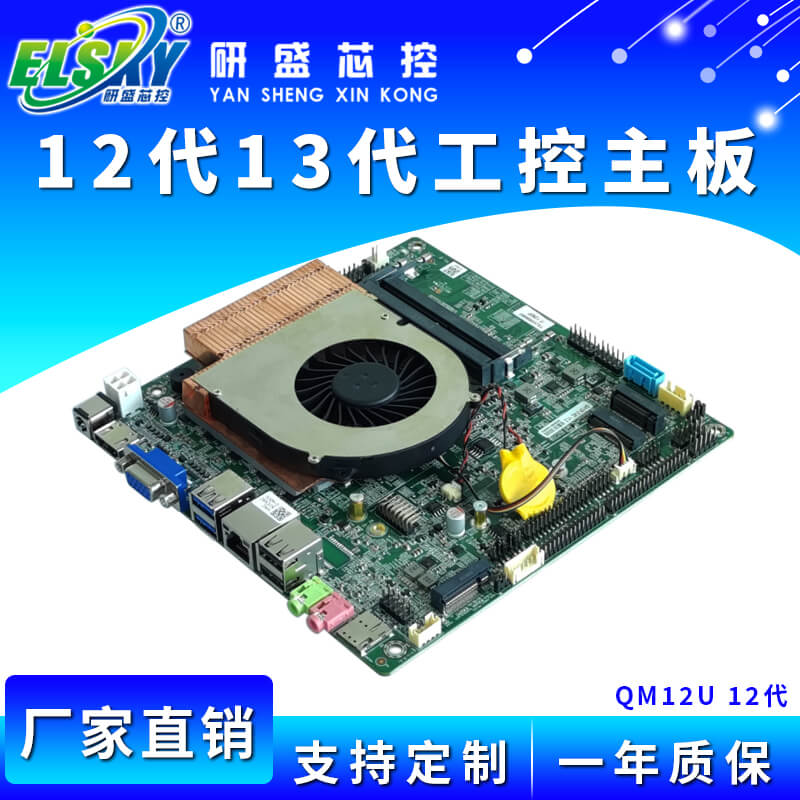
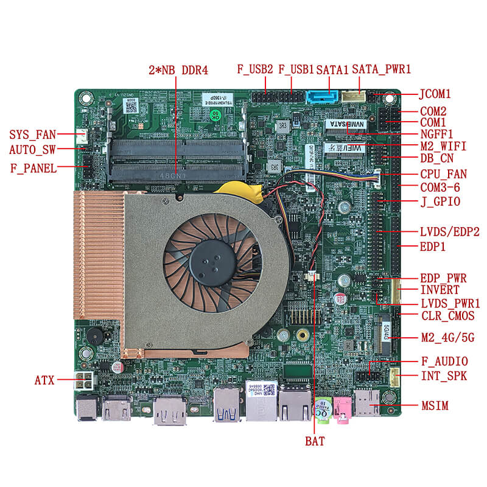
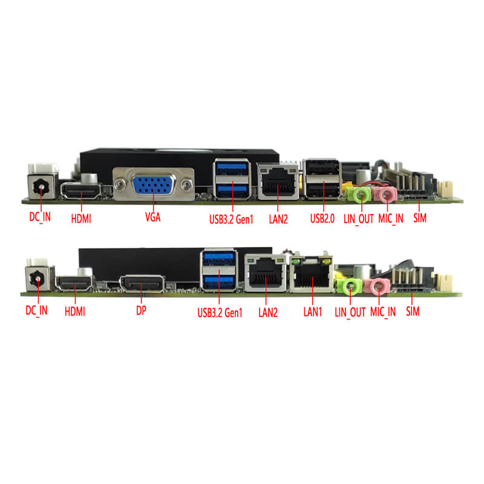

# I5 12450H

---

## 产品概览

| 项目 | 内容 |
| --- | --- |
| 产品名称 | ELSKY/研盛 QM12U QM13U 12代 13代 工控主板 |
| SKU | ELSKY-QM12U QM13U |
| 品牌 / 厂商 | 深圳市研盛芯控电子技术有限公司 |
| 官网页面 | https://www.miniboard.cn/products/elsky-qm12u-qm13u/ |
| 规格书下载 | https://www.miniboard.cn/wp-content/uploads/2026/09/研盛-QM12U-QM13U-V1.3主板说明书.doc |
| 主板型号 | QM12U（12 代）/ QM13U（13 代） |
| 板型 | MINI-ITX（170mm × 170mm） |

## 型号规格总表

| 主板型号 | CPU | 4K | LAN | COM | USB2.0 | USB3.2 | SSD | Memory | Power |
| --- | --- | --- | --- | --- | --- | --- | --- | --- | --- |
| QM12U | 支持 Intel Alder Lake 12 代 U/P/H 系列 i3、i5、i7、i9 | 支持 | 1 / 2 | 2 / 6 | 6 | 2 | 1×M.2 + 1×SATA | 2×NB-DDR4 MAX 64G | +12V / 19V |
| QM13U | 支持 Intel Raptor Lake 13 代 U/P/H 系列 i3、i5、i7、i9 | 支持 | 1 / 2 | 2 / 6 | 6 | 2 | 1×M.2 + 1×SATA | 2×NB-DDR4 MAX 64G | +12V / 19V |

## 详细规格参数

### 主板尺寸

170mm（L）× 170mm（W）× 21mm（H）（含风扇厚度）

### CPU

| 型号 | 支持处理器 |
| --- | --- |
| QM12U | 支持 Intel Alder Lake 12 代 U/P/H 系列 CPU |
| QM13U | 支持 Intel Raptor Lake 13 代 U/P/H 系列 CPU |

### 电源

| 接口 | 说明 |
| --- | --- |
| 1×DC_IN | DC 头内径 2.5mm，支持 12V / 19V |
| 1×DC_ATX（4Pin） | ATX 供电 |

功耗与电源建议：
- U 系列 CPU 最大睿频 55W，建议 12V 7A 或 19V 5A 以上电源
- P 系列 CPU 最大睿频 64W，建议 12V 7A 或 19V 5A 以上电源
- H 系列 CPU 最大睿频 115W，建议 12V 10A 或 19V 6.3A 以上电源

### 内存

| 接口 | 说明 |
| --- | --- |
| 2×SODIMM 插槽 | NB-DDR4 内存，支持 2133 / 2400 / 2666 / 2933 / 3200，最大 64G |

### 网络功能

| 接口 | 说明 |
| --- | --- |
| 1/2×RJ45_LAN | 单网：默认 Intel I219V 千兆网卡；双网：Intel I219V + Realtek 8111H 千兆网卡；支持网络唤醒、PXE |
| 1×M2_WIFI | PCIe 3.0 信号，Key-E 接口，支持 M.2 2230 WiFi/蓝牙模块 |
| 1×M2_4G/5G | Key-B 接口，支持 M.2 5G（3052/3042）或 M.2 4G（3042）模块 |
| 1×MSIM 卡槽 | 支持 SIM 卡，使用 5G/4G 时需要 |

### 显示功能

集成 Intel UHD Graphics 超核心显卡，支持单显、双显/三显/四显复制、双显/三显/四显扩展，SHELL 下双显。

| 接口 | 说明 |
| --- | --- |
| 1×HDMI 2.0 | 4K 分辨率 4096/3840×2160@60Hz |
| 1×HDMI_CON2 插针 | 4K 分辨率 4096/3840×2160@30Hz（16Pin，2×8Pin，2.0mm） |
| 1×VGA DB15 | 分辨率 1920×1080@60Hz |
| 1×DP（可选） | 支持 DP++，4K 分辨率 4096/3840×2160@60Hz；VGA 接口可改支持 DP |
| 1×LVDS/EDP2 插针 | LVDS1 支持 2K60Hz；EDP2 支持 4K60Hz（30Pin，2×15Pin，2.0mm） |
| 1×EDP1 插针 | EDP-C 屏线，4K 分辨率 4096/3840×2160@60Hz（30Pin，2×15Pin，2.0mm） |
| 1×LVDS_PWR1 插针 | LVDS1/EDP2 工作电压控制（6Pin，2×3Pin，2.0mm） |
| 1×EDP_PWR 插针 | EDP1 工作电压控制（6Pin，2×3Pin，2.0mm） |
| 1×INVERT 插针 | LVDS 背光控制（6Pin，1×6Pin，2.0mm） |

> 默认支持 LVDS，可选支持 EDP2，共用插针；EDP-B 屏线。

### USB 功能

| 接口 | 说明 |
| --- | --- |
| 2×USB3.2 | 后置标准 USB3.2 Gen1，最大传输带宽 5Gbps |
| 2×USB2.0 | 后置标准 USB2.0，最大传输带宽 480Mbps |
| 1×F_USB1 插针 | 前置 USB2.0，一组 2×USB2.0（9Pin，2×5Pin，2.54mm） |
| 1×F_USB2 插针 | 前置 USB2.0，一组 2×USB2.0（9Pin，2×5Pin，2.54mm） |

### 声音功能

集成 Realtek ALC897 HD 数字音频解码器，6 声道高保真音频控制器。

| 接口 | 说明 |
| --- | --- |
| 1×LINE_OUT | 音频输出（绿色） |
| 1×MIC_IN | 麦克风输入（红色） |
| 1×INT_SPK 插针 | 支持 8 欧 5 瓦喇叭输出（功放）（4Pin，1×4Pin，2.0mm） |
| 1×F_AUDIO 插针 | 标准音频插针（9Pin，2×5Pin，2.54mm） |

### 硬盘功能

| 接口 | 说明 |
| --- | --- |
| 1×M.2-SATA/PCIE | PCIe 4.0 信号，Key-M 接口，默认 M.2 2280 硬盘，可选 M.2 2242；支持 NVMe 与 SATA 协议自动切换 |
| 1×SATA1 | 标准 SATA 硬盘接口，支持 SATA 3.0 |
| 1×SATA_PWR1 插针 | 硬盘供电，可取电 5V、12V（4Pin，1×4Pin，2.54mm） |

### 开关功能

| 接口 | 说明 |
| --- | --- |
| 1×F_PANEL 插针 | 开关、电源灯、硬盘灯、重启插针（9Pin，2×5Pin，2.54mm） |
| 1×AUTO_SW 插针 | 硬件控制上电开机插针（3Pin，1×3Pin，2.0mm） |

### 其他 I/O

| 接口 | 说明 |
| --- | --- |
| 1×COM1 插针 | 支持标准 RS232/RS422/RS485 可选（BIOS 设置）（9Pin，2×5Pin，2.54mm） |
| 1×COM2 插针 | 只支持标准 RS232（9Pin，2×5Pin，2.54mm） |
| 1×COM3-6 插针 | 只支持标准 RS232（39Pin，2×20Pin，2.0mm） |
| 1×JCOM1 插针 | COM1 第 9 脚设置 0V/5V/12V（6Pin，2×3Pin，2.0mm） |
| 1×MSIM 卡槽 | 支持 SIM 卡，用 5G/4G 时需要 |
| 1×CLR_CMOS 插针 | 主板清零、放电插针（3Pin，1×3Pin，2.0mm） |
| 1×CPU_FAN 插针 | CPU 风扇插针，支持温控（4Pin，1×4Pin，1.25mm） |
| 1×SYS_FAN 插针 | 系统风扇插针（3Pin，1×3Pin，2.54mm） |
| 1×J_GPIO 插针 | GPIO 控制插针（10Pin，2×5Pin，2.0mm） |

### 运行环境

- 工作温度：-10℃ ~ 60℃
- 工作湿度：5% ~ 95% 相对湿度，无冷凝

### BIOS

AMI BIOS，支持上电开机、定时开机、远程开关机、设备智能识别。

### Watch Dog

看门狗编程，支持硬件复位功能（256 级，0 ~ 255 秒）。

### 操作系统

支持 Windows 11、Windows 10、LINUX 等。

## 应用场景

- 工业自动化：产线控制、设备监控、数据采集
- 机器视觉：AI 视觉检测、图像识别与分析
- 智慧商显：数字标牌、广告机、信息发布终端
- 医疗影像：医疗影像终端、诊断设备
- 智慧交通：交通信号管控、路网监测
- 物联网网关：数据汇聚、边缘计算节点

## 免责申明

- 本仓库所提供的内容均基于公开、合法渠道整理，仅供用户参考与学习之用。
- 严格遵守国家相关法律法规，尊重并保护个人隐私及知识产权。
- 如您认为相关内容涉及您的隐私、版权或其他合法权益，请及时联系，将依法核实并在必要时予以删除或下架。
- 对于因使用或无法使用本网站/平台内容所引发的任何直接或间接损失，不承担任何法律责任。
- 用户在使用过程中应自行判断信息的适用性，并承担相应风险。

